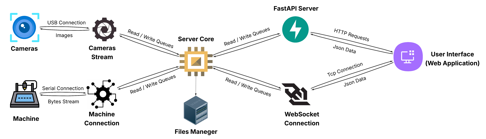

# Open-Lab-Operating-System (OLOS) Server

## Table of Contents

- [Introduction](#introduction)
- [Tech Stack](#tech-stack)
- [Installation & Setup](#installation--setup)
  - [1. Install Python](#1-install-python)
  - [2. Create a Virtual Environment](#2-create-a-virtual-environment)
  - [3. Install Dependencies](#3-install-dependencies)
  - [4. Configure the Server](#4-configure-the-server)
  - [5. (Optional) Set Up AI Image Generation](#5-optional-set-up-ai-image-generation-for-laser-cutter-only)
  - [6. Start the Server](#6-start-the-server)
- [Documentation](#documentation)
- [Software Architecture](#software-architecture)
  - [Core Process](#core-process)
  - [Machine Connection Process](#machine-connection-process)
  - [Websocket Connection Process](#websocket-connection-process)
  - [FastAPI Server Process](#fastapi-server-process)
  - [Cameras Stream Process](#camera-stream-process)
  - [Files Manager](#files-manager)
  - [Utils](#utils)

---

<!-- sphinx-start -->

## Introduction

**OLOS Server** is the backend system for the **Open Lab Operating System (OLOS)** — a unified platform to manage and operate various open-lab fabrication machines, such as:

- Laser Cutters
- CNC Machines
- Vinyl Cutters
- Metal 3D Printers

It acts as the central hub between the OLOS frontend and physical machines, enabling:

✅ **Operating Different Type of Machines**

✅ **Real Time Connections**

✅ **Job Execution**

✅ **Machine Control & Monitoring**

✅ **User Interaction**

OLOS Server ensures **safe, efficient, and user-friendly** operation of multiple digital fabrication devices in an open lab environment.

---

## Tech Stack

<a href="https://www.python.org/" title="Python"></a>
<a href="https://fastapi.tiangolo.com/" title="FastAPI"></a>
<a href="https://sqlite.org/" title="SQLite"></a>
<a href="https://websockets.readthedocs.io/en/stable/" title="WebSocket"></a>
<a href="https://en.wikipedia.org/wiki/REST" title="REST API"></a>
<a href="https://git-scm.com/" title="Git"></a>

---

## Installation & Setup

### 1. Install Python

Ensure **Python 3.11.9** is installed.  
Download it here: [Python 3.11.9 Download](https://www.python.org/downloads/release/python-3119/)

Verify installation:

```bash
python --version
```

---

### 2. Create a Virtual Environment

Run:

```bash
python -m venv venv
```

Activate it:

```bash
# Windows
Set-ExecutionPolicy Unrestricted -Scope Process
venv\Scripts\activate

# Linux / macOS
source venv/bin/activate
```

---

### 3. Install Dependencies

Before installing dependencies, check `requirements.txt`:

- If you are on **Linux** or **macOS**, comment out any Windows-only libraries.

Then install:

```bash
pip install -r requirements.txt
```

Then install the following:
https://github.com/tschoonj/GTK-for-Windows-Runtime-Environment-Installer/releases

---

### 4. Configure the Server

Edit the `config.yaml` file to match your machine and environment settings before running the server.

**PS** `.env` file contains the server environment configurations:

- **ENV** — Defines the environment mode for the application (development, production).
- **HOST** — The network interface on which the FastAPI server will listen and a WebSocket channel will be created.
- **FASTAPI_PORT** — Port number for the FastAPI REST API server.
- **WEBSOCKET_PORT** — Port number for the WebSocket server handling real-time communication

---

### 5. (Optional) Set Up AI Image Generation For Laser Cutter Only

If you want to use AI-powered image generation:

1. Create a folder named `AI_models` in the project root.
2. Download the required AI model and place it inside `AI_models`.
3. Supported models are listed in `config.yaml`.

---

### 6. Start the Server

With the virtual environment activated, run:

```bash
python src/main.py
```

---

## Documentation

After Starting the server, you can access the full documentation of the OLOS Server including the installation steps, the full source code and FastAPI EndPoints documentation by

- Opening `docs/build/html/index.html` file in your browser.
- Accessing the docs url (needs server to be running): `http://<'Server-IP'>:<'FastAPI-Port'>/docs/` **e.g. [http://localhost:8000/docs/](http://localhost:8000/docs/)**

---

## Software Architecture

<a href="docs/source/_static/images/OLOS_Server_Architecture.png" title="OLOS Server Architecture"></a>

The **OLOS Server** follows a modular, multiprocessing-based architecture designed for high responsiveness, real-time communication, and efficient coordination between multiple subsystems.

### Core Process

The **Core Process** is the central orchestrator of the OLOS Server, responsible for coordinating all subprocesses:

- **WebSocket Connection Process**

- **Machine Connection Process**

- **FastAPI Server Process**

- **Cameras Stream Process**

- **Files Manager (runs in the same process as the Core)**

The core uses a **Shared Data Manager** (implemented via Python’s multiprocessing.SyncManager) that provides **communication tunnels** between processes using **priority queues**.

- **Two queues per process:** one for sending data to the core, one for receiving data from the core.

- **Three priority levels:** High, Medium, Low. Messages are ordered dynamically by priority.

The core continuously monitors these queues in an **infinite loop** with a configurable time delay to reduce CPU usage. Incoming messages are analyzed, and the corresponding actions are executed based on message type.

### Machine Connection Process

Handles **serial communication** with the physical machine controller (currently compatible with **GRBL firmware**).

- Establishes and maintains the serial connection.

- Sends and receives machine commands and responses.

- Uses priority queues to exchange messages with the core.

- Continuously listens for incoming machine data and core instructions in a loop with a time interval delay.

### WebSocket Connection Process

Manages **real-time, bidirectional communication** between the user interface and the core.

- Relays messages from the UI to the core and vice versa.

- Utilizes priority queues for inter-process messaging.

- Runs in a loop with a configurable delay for efficient resource usage.

### FastAPI Server Process

Hosts a **REST API** for non-real-time operations such as job management, AI image generation, slicing operations, and material library updates.

- Runs as a separate subprocess.

- Routes incoming API requests to the core via priority queues.

- Integrates with **Swagger UI** and **ReDoc** for automatic API documentation.

### Cameras Stream Process

Video stream the image from connected cameras if camera stream is enabled

- Runs in a loop with a configurable delay for efficient resource usage.

- Runs as a separate subprocess.

- Uses priority queues to exchange messages with the core.

### Files Manager

A component running inside the core process responsible for managing all file operations in the system:

- **Job Files**

- **Media Files**

### Utils

Contains all reusable **helper modules and utility classes** shared across processes.

<!-- sphinx-end -->
